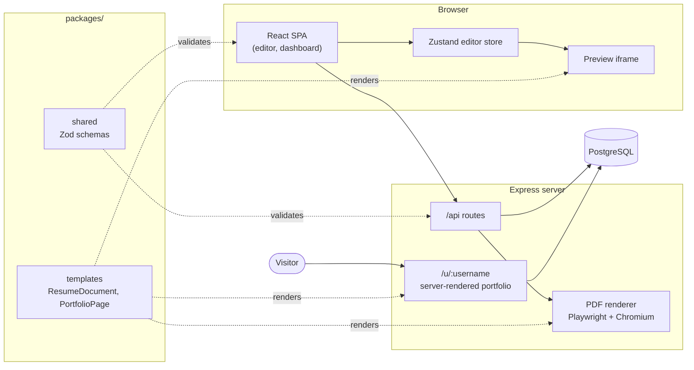

# FolioForge

A resume and portfolio builder. Fill in your career details in a structured editor, watch a live, print-accurate preview update beside it, download a pixel-perfect PDF, and publish the same content as a public portfolio page at `/u/your-username`.

Built as a full-stack TypeScript monorepo: React + Vite on the front end, Express + PostgreSQL on the back end, with Zod schemas shared between the two.

## Features

- **Structured editor**: personal info, summary, experience, education, skills, projects, certifications, languages and custom sections. Add, edit, delete, hide/show and drag-to-reorder (mouse, touch or keyboard).
- **Helpful validation**: the same Zod schemas validate the forms and the API, with messages that say how to fix things.
- **Autosave and undo/redo**: changes save about a second after you stop typing. Ctrl/⌘+Z and Ctrl/⌘+Shift+Z work across the whole editor.
- **Live preview**: exact A4 or US Letter pages with page breaks that match the PDF.
- **Themes**: Classic, Modern (two-column) and Minimal templates, accent colors, font pairings, spacing densities, and an ATS-friendly mode.
- **PDF export**: rendered on the server with headless Chromium, so text stays selectable and links stay clickable.
- **Multiple resumes and versions**: duplicate resumes, save named snapshots and restore older versions.
- **Public portfolio**: publish one resume as a server-rendered page with SEO, Open Graph tags and JSON-LD.
- **JSON Resume** import/export, compatible with the [JSON Resume](https://jsonresume.org/schema) ecosystem.
- **Accessible and responsive**: labelled fields, announced errors, keyboard drag-and-drop, dark mode for the app UI.

## Screenshots

> Add screenshots here, for example `docs/screenshots/editor.png`, `design.png`, `portfolio.png` and `mobile.png`.

## Quick start (Docker)

Requires Docker with Compose v2.

```bash
docker compose up --build
```

Open <http://localhost:3000> and sign in with the demo account:

| Email                 | Password            |
| --------------------- | ------------------- |
| `demo@folioforge.dev` | `demo-password-123` |

The demo user has two resumes; "Frontend roles" is published at <http://localhost:3000/u/demo>. Migrations and demo seeding run automatically on startup. To reset all data: `docker compose down -v`.

## Local development

Requires Node.js 20.19+ (22 recommended) and npm 10+.

```bash
cp .env.example .env
npm install
docker compose up -d db          # PostgreSQL only
npx playwright install chromium  # browser used for PDF export (one time)
npm run dev                      # API on :3000, Vite on :5173
```

Open <http://localhost:5173>.

**No Docker?** Set `DATABASE_URL=pglite:./apps/server/.pglite` in `.env` to use an embedded PostgreSQL (PGlite).

### Scripts

| Command               | What it does                                           |
| --------------------- | ------------------------------------------------------ |
| `npm run dev`         | API and web app together                               |
| `npm run build`       | Production build                                       |
| `npm start`           | Run the production server                              |
| `npm run lint`        | ESLint across the monorepo                             |
| `npm run typecheck`   | Type-check every workspace                             |
| `npm test`            | Unit and API tests (no database needed)                |
| `npm run e2e`         | Build, then run the Playwright end-to-end test         |
| `npm run db:generate` | Generate a migration after editing the schema          |
| `npm run db:migrate`  | Apply migrations to `DATABASE_URL`                     |
| `npm run db:seed`     | Apply migrations and create the demo user              |

## Tech stack

| Area      | Technologies                                                                  |
| --------- | ----------------------------------------------------------------------------- |
| Front end | React, Vite, Tailwind, React Hook Form, dnd-kit, Tiptap, TanStack Query, Zustand |
| Back end  | Express, Drizzle ORM, PostgreSQL (PGlite for tests)                           |
| Shared    | Zod schemas and types, JSON Resume conversion                                 |
| PDF       | Playwright + headless Chromium                                                |
| Testing   | Vitest, Supertest, Playwright                                                 |

## Architecture



### Repository layout

```
apps/
  web/            React + Vite SPA (editor store, autosave, forms, preview)
  server/         Express API, Drizzle schema + migrations, PDF renderer, SSR pages
packages/
  shared/         Zod schemas and types, JSON Resume conversion, sample data
  templates/      Resume templates and portfolio page (React components + CSS)
e2e/              Playwright end-to-end test
```

## Key design decisions

- **One renderer for preview, PDF and public page.** The same `ResumeDocument` component powers all three, so what you see is what you download.
- **PDF via headless Chromium.** Gives selectable text, embedded fonts and real CSS paged media. The HTML is self-contained, JavaScript is disabled and all network requests are blocked to prevent SSRF.
- **Drizzle over Prisma.** Readable SQL migrations, no native engine, and the same code runs on node-postgres and PGlite.
- **Server-side sessions, not JWT.** Random tokens stored as SHA-256 hashes in an `httpOnly` cookie; revocable, with scrypt password hashing, rate limiting and Origin checks against CSRF.
- **Server-rendered portfolio.** Complete HTML with SEO and Open Graph tags, and no client JavaScript.
- **Resume stored as one `jsonb` document.** Matches how it is read and written; Zod enforces structure at the API boundary.
- **Autosave with optimistic concurrency.** Saves are revision-checked; a conflict returns 409 instead of silently overwriting.
- **Full-copy version history.** Restores run in one transaction and snapshot the current state first, so they are always undoable.

## Testing

- **Unit tests** (Vitest): schemas, dates, JSON Resume round trips, templates, editor store.
- **API tests** (Vitest + Supertest): auth, CRUD, conflicts, sanitization, ownership, versions, publishing, PDF and public pages, run against in-memory PostgreSQL.
- **End-to-end** (Playwright): sign up, edit, autosave, PDF download, publish.
- **CI** (GitHub Actions): lint, type-check, tests, build, migrations and e2e.

## Configuration

See [`.env.example`](.env.example). Key variables: `DATABASE_URL`, `PUBLIC_URL`, `ALLOWED_ORIGINS`, `COOKIE_SECURE`, `RUN_MIGRATIONS`, `SEED_DEMO`, `CHROMIUM_EXECUTABLE_PATH`.

## Future improvements

- Background PDF jobs with a queue and caching
- Unique visitor counts
- Object storage for photos
- Real-time collaboration
- Email verification, password reset and OAuth
- More templates and custom domains
- Structured logging and observability
